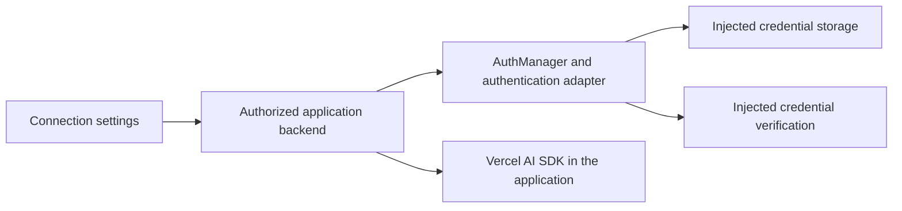

# Cloud authentication

Synapse can coordinate provider authentication in a Node.js backend such as Resonanz Cloud. Authentication adapters use `AiAuthDriverBase` and `AuthManager` independently of an execution driver. An API-key connection does not require an installed CLI. This works with Vercel AI SDK: Synapse manages connection authentication and credential lifecycle; the application uses its AI SDK provider for model calls, streaming and tools.

## Browser and backend ownership

The browser presents connection settings and the currently active authentication interaction. The backend authenticates the application user, authorizes the selected connection and owns the Synapse authentication handle. Neither an interaction identifier nor a client-supplied connection identifier replaces the application's authorization checks.



| Owner                         | Responsibility                                                                                                                                            |
| ----------------------------- | --------------------------------------------------------------------------------------------------------------------------------------------------------- |
| Browser UI                    | Display supported methods and safe state, collect an explicitly requested credential, submit a correlated response and cancel an abandoned interaction.   |
| Application backend           | Enforce user/tenant ownership, select the provider connection, retain handles, protect endpoints and choose credential storage and verification policies. |
| Synapse authentication        | Coordinate the explicit login/logout lifecycle, interaction ownership, cancellation, verification and profile admission.                                  |
| Injected credential storage   | Persist and retrieve secrets under the application's account and connection boundaries. Encryption, key management and deployment access belong here.     |
| Application inference library | Build and execute provider requests using credentials resolved on the backend.                                                                            |

OpenAI's API authentication documentation requires API keys to remain secret and recommends loading them from server-side environment variables or key management. Its bearer credentials must not be embedded in shipped frontend code or returned with connection status. A settings form may collect a user-supplied key for an authorized backend operation; the backend must treat that submitted value as secret and return only safe status. [OpenAI API authentication](https://developers.openai.com/api/reference/overview#authentication)

Keep keys out of browser persistence, URLs, analytics, application logs and authentication progress messages. A verification adapter must return safe authentication metadata rather than the provider's raw response or credential. It must verify credentials without starting an inference request.

## Connection identity

An application user, an application account and a provider connection are different identities:

- Resolve the user and any tenant/workspace from the authenticated backend session.
- Choose `applicationId` for the owning application and `accountId` for its stable, isolated account boundary. These values are identifiers, never credentials.
- Use a distinct profile/instance for each independently managed provider connection, including two connections to the same provider. Do not share mutable profile state across unrelated users or applications.
- Keep the selected authentication adapter's identity separate from the provider's account identifier and the host's connection identifier.

The backend maps those identities to the selected `IAiInstance` before calling Synapse. It must repeat authorization when responding to an interaction, reading status, replacing a key or disconnecting an account. `ownerId`, `operationId` and `interactionId` correlate a response to one pending flow; knowledge of those values does not authorize access to a connection.

The injected `ApiKeyStoreBase` receives the complete `IApiKeyCredentialScope`: `applicationId`, `accountId`, `driverId`, `instanceId` and `profileId`. Use the whole tuple for storage isolation. `apiKeyCredentialScope(instance)` from `@pixel-brewery/synapse-auth` returns the same detached, immutable scope for the host's backend secret reads. It performs no authorization or credential lookup. `ApiKeyVerifierBase` receives that scope to select the correct provider/account verification policy.

## Compose API-key authentication without execution

The following backend composition uses `ApiKeyAuthDriver` from `@pixel-brewery/synapse-auth`. Its `store` parameter is an actual host implementation of `ApiKeyStoreBase`; there is no default encrypted store. Its `verifier` can be a host implementation or one of the optional fixed-endpoint adapters from `@pixel-brewery/synapse-auth-providers`. Neither package implements model calls. Create these owners once for the backend admission domain and reuse them across connection operations.

```ts
import { ApiKeyAuthDriver, AuthManager, ProfileManager } from '@pixel-brewery/synapse-auth';
import type { ApiKeyStoreBase, ApiKeyVerifierBase } from '@pixel-brewery/synapse-auth';
import { ProfileAccessCoordinator } from '@pixel-brewery/synapse-runtime';
import type { ProfileSessionStoreBase } from '@pixel-brewery/synapse-runtime';

export function createCloudAuthentication(
    rootDirectory: string,
    store: ApiKeyStoreBase,
    verifier: ApiKeyVerifierBase,
    sessionStore?: ProfileSessionStoreBase,
) {
    const profiles = new ProfileManager({ rootDirectory });
    const access = new ProfileAccessCoordinator(5_000, 4096, sessionStore);
    const authentication = new AuthManager(access);
    const apiKeys = new ApiKeyAuthDriver(store, verifier);

    return { profiles, access, authentication, apiKeys };
}

export async function startConnectionLogin(
    services: ReturnType<typeof createCloudAuthentication>,
    connection: {
        readonly id: string;
        readonly accountId: string;
        readonly providerId: string;
        readonly ownerId: string;
    },
) {
    const profile = await services.profiles.create({
        applicationId: 'resonanz-cloud',
        accountId: connection.accountId,
        driverId: connection.providerId,
    });
    const instance = { id: connection.id, driverId: connection.providerId, profile };
    const login = services.authentication.start(instance, services.apiKeys, {
        ownerId: connection.ownerId,
        methodId: 'api-key',
    });

    return { instance, login };
}
```

`rootDirectory` is an absolute, backend-owned profile directory supplied by deployment configuration. The `connection` argument comes from the backend's authorized connection record. Its `accountId` is an isolated, host-assigned connection owner identity; allocate a different one for independently managed connections. `providerId` is an open host identifier such as `openai-api-key`, with no execution driver registered for that identifier.

This composes authentication without `AiRuntime`, `NodeProcessRunner` or an installed provider CLI. Current profile contracts still include local backend paths: `ProfileManager` creates owned directories, and `ProfileAccessCoordinator` uses file-backed session-generation metadata by default. The API key itself goes only to the injected secret store. Supplying a `ProfileSessionStoreBase` changes generation-metadata storage; it does not remove `ProfileManager`'s filesystem contract.

Implement `ApiKeyStoreBase.read`, `write` and `remove` against the application's secure storage. Writes must atomically replace one scoped key, check cancellation before commit and retain the previous key on failure before commit. Select an optional verifier such as `OpenAiApiKeyVerifier` from `@pixel-brewery/synapse-auth-providers/openai`, or implement `ApiKeyVerifierBase.verify` with the host's bounded authentication check. A stored string or a recognized key prefix is insufficient verification; a successful metadata check also does not prove model entitlement, inference permission, billing readiness or remaining budget. HTTP 401/403 leave the probe unverified and can reflect endpoint restrictions rather than a universally invalid key. See [the five verification endpoints and their headers/options](../../libs/synapse-auth-providers/README.md#select-an-authentication-verifier).

## Use with Vercel AI SDK

Vercel AI SDK and Synapse authentication serve different application responsibilities and compose directly. After an authorized connection completes the API-key flow, the backend reads the same scoped secret and passes it to the selected AI SDK provider. No `LanguageModel` wrapper, inference gateway or model catalog is added to Synapse, and Synapse packages have no dependency on `ai` or `@ai-sdk/*`.

This consumer-only factory uses the documented `createOpenAI` API. The consuming application supplies its own `@ai-sdk/openai` dependency and its actual `ApiKeyStoreBase` implementation:

```ts
import { createOpenAI } from '@ai-sdk/openai';
import { apiKeyCredentialScope } from '@pixel-brewery/synapse-auth';
import type { ApiKeyStoreBase } from '@pixel-brewery/synapse-auth';
import type { IOpenAiApiKeyVerifierOptions } from '@pixel-brewery/synapse-auth-providers/openai';
import { AiError } from '@pixel-brewery/synapse-core';
import type { IAiInstance } from '@pixel-brewery/synapse-core';

export async function createConnectionOpenAiProvider(
    secretStore: ApiKeyStoreBase,
    instance: IAiInstance,
    signal: AbortSignal,
    selectors: IOpenAiApiKeyVerifierOptions = {},
) {
    signal.throwIfAborted();

    const apiKey = await secretStore.read(apiKeyCredentialScope(instance), signal);

    signal.throwIfAborted();

    if (!apiKey) throw new AiError('auth-required', 'This connection has no stored API key.');

    return createOpenAI({
        apiKey,
        organization: selectors.organization,
        project: selectors.project,
    });
}
```

The factory performs no model call and returns no key to the browser. Use the same `organization`/`project` values when constructing `OpenAiApiKeyVerifier(undefined, selectors)` and the AI SDK provider. For Anthropic, keep any `workspaceId` selection consistent with the application's inference client as well. The official OpenAI provider documentation supports explicit `apiKey`, `organization` and `project` settings. [Vercel AI SDK OpenAI provider](https://ai-sdk.dev/providers/ai-sdk-providers/openai#provider-instance)

Call this factory while the host holds an execution lease from the same `ProfileAccessCoordinator` used by `AuthManager`. Register cancellation with `access.enter(instance.profile.id, abort)`, propagate it to the later AI SDK operation and retain the lease through final stream cleanup. Release only when that operation has stopped. The factory does not acquire or release the lease itself because the consuming application owns the full operation. Do not cache the provider with an old key across credential changes. A multi-worker deployment needs the host's connection coordination beyond this in-process lease.

## API-key connection lifecycle

`ApiKeyAuthDriver` advertises method `api-key` and a credentials interaction with secret field `apiKey`. The backend discovers the adapter's supported method, starts it through `AuthManager` and forwards the declared input fields and safe interaction metadata to its settings UI. The UI submits the key to the backend with the current correlation identifiers. `login.respond({ ownerId, operationId, interactionId, values: { apiKey } })` supplies the response to the active handle; the backend derives the authorized owner, checks the current operation and retains submitted values only for the secret operation.

The candidate key is verified before storage replacement. Rejected input, rejected verification and cancellation before storage preserve the previous key. `AuthManager` then performs a separate status verification before `login.result` succeeds. A failure after the storage commit can leave the replacement key stored, so do not interpret every failed final result as proof that no change committed. Query status through the same authorized connection owner to establish the current state.

Keep operation handles on the backend, bound to the authenticated owner and connection. A cancelled, expired or stale UI interaction must not update another account. Cancellation and shutdown must be awaited. The application's storage and verification adapters must honor cancellation and the selected account boundary.

Credential replacement and disconnection use the same profile coordinator as active consumers of that connection. If another library owns inference, the host must integrate its cancellation and cleanup with that coordinator's execution leases. Merely sharing a secret store does not coordinate running requests. The coordinator operates within one process; a multi-worker cloud service needs application-owned routing or distributed coordination for concurrent writes to the same connection.

Disconnecting the application's connection removes its stored credential according to the supplied adapter's contract. It does not imply that the upstream provider has revoked the API key. Provider-side revocation is a separate explicit action owned by the host.

Use `authentication.status(instance, apiKeys)` to check the stored key and `authentication.logout(instance, apiKeys)` to disconnect it. At backend shutdown, cancel and await pending login handles and call `authentication.dispose()`. The host separately owns shutdown of its storage, verifier and inference-library resources.

## API keys and ChatGPT subscription access

| Access path                          | Meaning for Resonanz Cloud                                                                                                                                                                        |
| ------------------------------------ | ------------------------------------------------------------------------------------------------------------------------------------------------------------------------------------------------- |
| OpenAI Platform API key              | Server-side API authentication with the selected Platform organization/project. Usage follows API billing and policy.                                                                             |
| Native Codex ChatGPT login           | Subscription access for supported Codex clients and their native account lifecycle. A browser sign-in interaction alone does not turn this into a general hosted API credential.                  |
| Sign in with ChatGPT with plan usage | A separate official OAuth integration with explicit consent and granted scope. A remotely hosted application must confirm its permitted integration and registration before exposing this option. |

The native Codex documentation distinguishes ChatGPT subscription sign-in from API-key sign-in. API-key usage follows OpenAI Platform billing and does not use included ChatGPT plan credits. [Codex authentication](https://learn.chatgpt.com/docs/auth)

Current Sign in with ChatGPT documentation describes optional permission to use a user's ChatGPT plan for eligible Responses API calls. The open-source registration flow is documented for open-source and locally hosted apps; paid or remotely hosted apps are directed to OpenAI's interest form. These docs do not establish Resonanz Cloud's eligibility or approve a hosted registration. [Sign in with ChatGPT overview](https://developers.openai.com/siwc/token-sharing-open-source), [Hosted-app interest form](https://openai.com/form/sign-in-with-chatgpt-interest/)

Hosted Sign in with ChatGPT is a future integration for Resonanz Cloud; a hosted registration has not been confirmed. Do not reuse Codex's client identity or assume the open-source loopback registration flow is suitable for a remote cloud application. A future cloud OAuth adapter must use the integration's confirmed client registration, callback URLs, scopes and token lifecycle. This guide does not configure or implement that unconfirmed path.

Identity sign-in and permission to consume ChatGPT plan usage are also distinct. An OAuth result can provide identity without granting `chatgpt.tokens.use.direct`; the application must retain that distinction in its connection state and billing selection. Declined plan permission or exhausted plan usage must not silently switch to API-key billing. [Sign in with ChatGPT errors and recovery](https://developers.openai.com/siwc/token-sharing-open-source/errors-and-recovery)

## Relationship to native integrations

Existing CLI and ACP authentication adapters retain their provider-specific procedures and profile isolation. A cloud application selects only the authentication adapters it actually supports. Importing Synapse authentication neither installs a CLI nor starts provider execution or a login flow.

See [the consumer guide](consumers.md#explicit-authentication) for the existing shared lifecycle and [the authentication package](../../libs/synapse-auth/README.md) for its public composition API.
