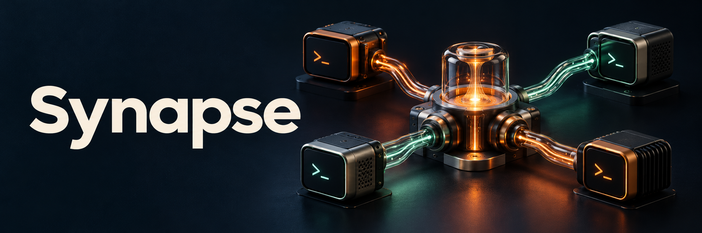
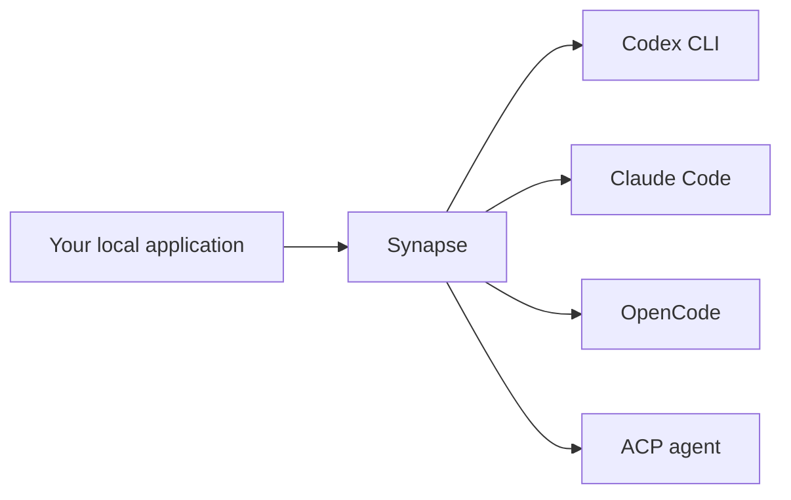

<p align="center">
  
</p>

# Synapse

**Bring AI to local applications through the CLIs already on the machine.**

Native sign-in. Independent application and account profiles. Resumable runs. Policy-controlled routing. Small TypeScript packages you compose yourself.


[](LICENSE)

[Try the example](#try-it-from-a-checkout) · [Providers](#providers) · [Packages](#packages) · [Agent documentation](#documentation-for-your-coding-agent) · [Documentation](.docs/README.md) · [Comparison](.docs/guides/comparison.md)

> **Initial family version: `0.0.1`.** Synapse is MIT licensed and is being prepared for public source hosting at [pixel-brewery/synapse](https://github.com/pixel-brewery/synapse). The owner must complete the [public source launch](.docs/guides/releases.md#public-source-launch), including repository transfer and visibility, separately from package publication. All ten packages target public GitHub Packages at `npm.pkg.github.com` under `@pixel-brewery`. Install a published version after [registry verification](.docs/guides/releases.md#first-publication-and-verification); [registry authentication](.docs/guides/consumers.md#install-from-github-packages) is required even for public GitHub npm packages. Local [verified archives](.docs/guides/consumers.md#local-archive-alternative) are also available.

## Why Synapse exists

A local application can call an AI CLI in a few lines. The difficult part arrives when it needs a second account, a login screen, a resumed session, a cancelled child process or a fallback that must not repeat a write.

Synapse puts those concerns behind one application-facing runtime. It grew out of Symphony's desktop orchestration: the same integration should also work in a small Node tool, a background utility or an application processing meeting transcripts.

Your application supplies the prompt and decides what may happen. Synapse coordinates the selected CLI, its profile, its execution and its lifecycle. Business workflows, approval decisions, databases and result presentation stay with your application.



Supported native subscription sign-in avoids a mandatory API key. Inference follows the selected CLI and account: a local process can still call a remote model service.

Read the [project story](.docs/guides/why-synapse.md) for the motivation, design choices and examples beyond desktop orchestration.

## Built for the application boundary

| What your application needs                                  | What Synapse provides                                                                                                                    |
| ------------------------------------------------------------ | ---------------------------------------------------------------------------------------------------------------------------------------- |
| Two tools or two accounts without shared mutable login state | Application/account profiles and explicit mappings for existing native directories                                                       |
| A credential change while work is running                    | One coordinator drains affected runs, blocks new admission and invalidates old session generations before mutation                       |
| A run that survives beyond one request                       | Complete session references bound to driver, instance, profile, candidate and authentication generation                                  |
| Streaming without unbounded event retention                  | A bounded `AsyncIterable`, an independent result promise, deadlines and `AbortSignal` cancellation                                       |
| Fallback with an explicit retry policy                       | Queues, concurrency limits, quota pauses and circuit state; failover requires a repeatable request, with an additional opt-in for writes |
| Only the integrations you actually use                       | Nine packages, explicit driver composition, native ESM and inert imports; packed artifacts are checked with esbuild and Rollup           |

Native permission modes belong to the selected CLI. Synapse checks declared capabilities before launch and negotiated ACP capabilities before submitting a prompt. The host remains responsible for its approval policy. See the [runtime contract](libs/synapse-runtime/README.md) and [provider-specific limits](.docs/guides/cli-compatibility.md).

## Try it from a checkout

Use **Node.js 24.15+** and the pinned **Yarn 4.18.1**. No AI account is needed for the first example.

```sh
corepack enable
yarn install --immutable
yarn nx run meeting-notes:build --parallel=1
yarn workspace @pixel-brewery/synapse-meeting-notes-example start --simulate
```

The example turns a supplied synthetic meeting transcript into schema-validated JSON:

```json
{
    "summary": "The team agreed to prepare a Friday release after testing.",
    "decisions": ["Target the release for Friday after tests pass."],
    "tasks": [
        { "description": "Run the release tests on Thursday.", "owner": "Mira" },
        { "description": "Prepare the release announcement.", "owner": "Alex" }
    ]
}
```

Simulation is explicit and performs no inference. It exercises the real runtime and schema validation with a declared fixture. The example needs no Symphony, Electron or Git repository.

To use an installed Codex CLI and explicitly start native login:

```sh
yarn workspace @pixel-brewery/synapse-meeting-notes-example start --provider codex --account personal --login
```

The example owns a separate profile; it does not silently reuse global credentials. The [example guide](apps/meeting-notes/README.md) covers Claude Code, OpenCode, profile paths and cancellation. Audio capture and transcription are separate application concerns.

## A run in your application

Pass an already authenticated application-owned profile and the same coordinator used by your auth manager:

```ts
import type { IAiProfile } from '@pixel-brewery/synapse-core';
import { CodexDriver } from '@pixel-brewery/synapse-provider-codex';
import {
    AiRuntime,
    NodeProcessRunner,
    ProfileAccessCoordinator,
} from '@pixel-brewery/synapse-runtime';

async function summarize(
    profile: IAiProfile,
    access: ProfileAccessCoordinator,
    transcript: string,
    signal: AbortSignal,
) {
    const driver = new CodexDriver(new NodeProcessRunner());
    const runtime = new AiRuntime({
        drivers: [driver],
        instances: [{ id: 'notes', driverId: driver.id, profile }],
        access,
    });

    try {
        return await runtime.run({
            target: { instanceId: 'notes' },
            prompt: `Summarize the decisions and follow-up tasks:\n\n${transcript}`,
            policy: { mode: 'read-only' },
            signal,
        }).result;
    } finally {
        await runtime.dispose();
    }
}
```

This function owns its runtime and driver for one job. A long-running application normally creates them once and disposes them at shutdown. The [consumer guide](.docs/guides/consumers.md) covers profile creation, native login interactions, event streams, JSON Schema results, session persistence and cleanup failures.

## Providers

| Adapter                                               | Execution                                      | Authentication                                                            | Structured results                                         |
| ----------------------------------------------------- | ---------------------------------------------- | ------------------------------------------------------------------------- | ---------------------------------------------------------- |
| [Codex](libs/synapse-provider-codex/README.md)        | Native `exec` JSON events; metadata inspection | Native browser/device sign-in; explicit key/token methods where available | Native schema output plus local validation                 |
| [Claude Code](libs/synapse-provider-claude/README.md) | Native noninteractive streaming CLI            | Native subscription, console and SSO methods where available              | Native schema output plus local validation                 |
| [OpenCode](libs/synapse-provider-opencode/README.md)  | Native noninteractive CLI                      | Native provider/method selection or explicit credential import            | Local schema validation                                    |
| [ACP](libs/synapse-provider-acp/README.md)            | Official ACP SDK over stdio                    | Host-supplied native auth adapter when needed                             | Local schema validation; other capabilities are negotiated |

Drivers advertise actual capabilities and auth methods. Additional drivers use the same public contracts without changing a central provider enum. Installation and updates are explicit host actions. See [characterized CLI versions and verification evidence](.docs/guides/cli-compatibility.md). For account-dependent tests, use the explicit [native account verification](.docs/guides/native-verification.md) after signing into a dedicated test profile.

## Packages

Every npm name begins with `@pixel-brewery/`. Choose the packages your host needs; providers are never registered globally.

| Package                                                               | Responsibility                                                                                                   |
| --------------------------------------------------------------------- | ---------------------------------------------------------------------------------------------------------------- |
| [synapse-core](libs/synapse-core/README.md)                           | Provider-neutral contracts, capabilities, events, session references and typed errors; zero runtime dependencies |
| [synapse-runtime](libs/synapse-runtime/README.md)                     | Processes, workspaces, bounded streams, deadlines, cancellation, session storage and profile coordination        |
| [synapse-auth](libs/synapse-auth/README.md)                           | Application/account profiles and correlated native login/logout flows                                            |
| [synapse-routing](libs/synapse-routing/README.md)                     | Candidate selection, admission queues, concurrency, circuit state and quota cooldowns                            |
| [synapse-provider-codex](libs/synapse-provider-codex/README.md)       | Codex execution, auth, sessions and metadata                                                                     |
| [synapse-provider-claude](libs/synapse-provider-claude/README.md)     | Claude Code execution, auth and session normalization                                                            |
| [synapse-provider-opencode](libs/synapse-provider-opencode/README.md) | OpenCode execution, account selection/import and session normalization                                           |
| [synapse-provider-acp](libs/synapse-provider-acp/README.md)           | An extensible ACP stdio driver with explicit native permission mappings                                          |
| [synapse-testing](libs/synapse-testing/README.md)                     | Simulated drivers and transport replays for account-free application tests                                       |

Public APIs have English TSDoc. TypeDoc generates [portable Markdown references and reflection JSON](.docs/guides/api-documentation.md), ready to embed in a future documentation site. The nine runtime libraries remain independently composable; the optional developer tool below adds no dependency to an application.

## Documentation for your coding agent

[`@pixel-brewery/synapse-mcp`](tools/mcp/README.md) supplies local package documentation, the complete generated API reference, integration guides and nine Synapse architecture patterns through 15 MCP tools. It follows Archipel's documentation-tool interface with Synapse-specific contracts and examples.

Build it from this checkout, then let an MCP client start it over stdio:

```sh
yarn nx run synapse-mcp:build
yarn workspace @pixel-brewery/synapse-mcp start
```

The server uses the official MCP TypeScript SDK and a corpus bundled into its own package. It only serves development knowledge: it needs no provider account or API key and does not start login or AI runs. Standard output carries MCP protocol messages. See the [MCP guide](.docs/guides/mcp.md) for Codex, Claude Code, OpenCode and generic stdio configuration, all tool inputs and local archive usage. Install a verified published version through the authenticated GitHub registry, or run a verified local archive.

## Where Synapse fits

The useful distinction is the boundary each library owns. Broader provider coverage, a smaller runner and a workflow SDK can each be the better fit for a different application.

| Project                                                                   | Main focus                                                                                            | Choose it when…                                                                                                 |
| ------------------------------------------------------------------------- | ----------------------------------------------------------------------------------------------------- | --------------------------------------------------------------------------------------------------------------- |
| **Synapse**                                                               | **Application/account lifecycle, CLI execution and policy-controlled routing in composable packages** | **Your application needs independent profiles, coordinated credential changes and owned run/session lifecycle** |
| [Agents Wire](https://github.com/pivanov/agents-wire)                     | Broad ACP agent coverage, orchestration and process pools                                             | Agent breadth and POSIX/WSL orchestration are your priority                                                     |
| [Coding Agent Runner](https://github.com/yinguangyao/coding-agent-runner) | A slim normalized execution API for several coding CLIs                                               | Your host already owns login, credentials and task queues                                                       |
| [Unigent](https://github.com/gintasz/unigent)                             | Typed agent-backed functions and TypeScript workflows                                                 | Schema-driven completion, forks and workflow composition are your main abstraction                              |

The [detailed comparison](.docs/guides/comparison.md) also covers Agent CLI SDK and AI SDK community adapters, with source links, exact review scope and unverified items. Synapse does not require Vercel AI SDK or RxJS; its public async contracts use promises, `AsyncIterable` and `AbortSignal`.

## Documentation and verification

Start at the [documentation hub](.docs/README.md). Integration guidance, all nine package references, architecture decisions, CLI compatibility and release instructions live alongside the code. Repository-hosted guides become publicly accessible with the owner's public source launch; GitHub Packages availability is verified independently. The MCP package carries its documentation corpus, and checkout-relative links also work locally.

```sh
yarn verify
yarn packaging:verify
```

Artifact verification installs real package archives in a separate consumer, validates declarations and inert imports, checks provider exclusion in esbuild/Rollup bundles and runs the independent simulated example. Ordinary tests require no personal AI accounts.

Local verification has run on macOS with Node.js 24. The configured CI matrix targets macOS, Linux and native Windows; remote matrix runs and live account/CLI checks remain separate evidence. See the [compatibility guide](.docs/guides/cli-compatibility.md).

## Contribute

See [CONTRIBUTING.md](CONTRIBUTING.md) for setup, focused checks and the [Synapse Architect](.agents/skills/synapse-architect/SKILL.md) engineering contract. Sensitive findings follow [SECURITY.md](SECURITY.md). Release preparation is documented in the [release guide](.docs/guides/releases.md).

Synapse is MIT licensed. See [LICENSE](LICENSE) and [NOTICE](NOTICE.md) for attribution and reference context.
